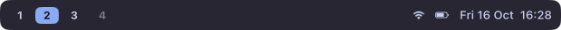
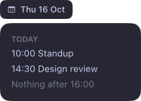

# Surfaces

A `<Surface>` is a window. Its child fills it.



```tsx
<Surface
  screen={screen}
  anchor={["top", "left", "right"]}
  margins={[4, 8, 0, 8]}
  size={{ height: 32 }}
>
  <Box style={{ background: "#1e1e2e", radius: 8 }} />
</Surface>
```

## Placement

| Prop      | Values                                                                                        |
| --------- | --------------------------------------------------------------------------------------------- |
| `screen`  | A display from `<PerScreen>` or `screens()`.                                                  |
| `anchor`  | Edges to pin to: `top`, `bottom`, `left`, `right`. None centers it.                           |
| `margins` | `8`, `[vertical, horizontal]` or `[top, right, bottom, left]`.                                |
| `size`    | Per axis: points, `"fill"` (between two anchors) or `"auto"` (fits the content, the default). |
| `avoid`   | `["menuBar", "notch"]` shifts it clear of them.                                               |

## Stacking and input

| Prop    | Values                                                                                           |
| ------- | ------------------------------------------------------------------------------------------------ |
| `layer` | `desktop` (under windows), `belowMenu`, `aboveMenu` (over windows), `overlay` (over almost all). |
| `input` | `passthrough` (default), `hover`, `interactive` (clicks), `keyboard` (clicks + typing).          |

Empty parts of an interactive surface let clicks through. Widgets never activate halo: your app keeps focus, even
while you type into a `keyboard` surface.

## One per display

```tsx
<PerScreen>{(screen) => <Bar screen={screen} />}</PerScreen>
```

Instances come and go with displays.

## Show and hide

```tsx
<Surface name="launcher" defaultHidden screen={screen} input="keyboard">
  …
</Surface>
```

```bash
halo toggle launcher   # also: show, hide, --all
```

From code: `show("launcher")`, `hide(…)`, `toggle(…)`. `visible={signal}` hides it from inside. Bind `halo toggle` to
a hotkey in your window manager.

## Popups

```tsx
let button: NativeNode | undefined;
<Box ref={(node) => (button = node)} onClick={() => open.set(true)} />
<Surface screen={screen} visible={open} attach={() => ({ to: button, side: "below", offset: 6 })}
         onClickOutside={() => open.set(false)}>…</Surface>
```



An attached surface sits next to a node of another surface, stays on screen and follows the node.

## Notes

- Widgets hide while a fullscreen app is showing.
- They live on one Space; tiling window managers like AeroSpace keep everything there.

Reference: [`Surface`](../reference/halo.html#Surface), [`SurfaceProps`](../reference/halo.html#SurfaceProps).
