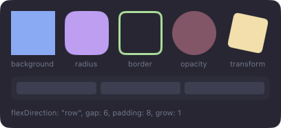
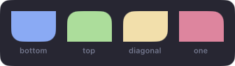
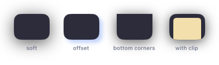
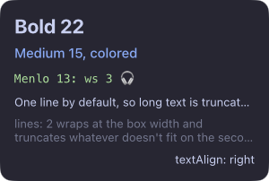
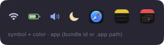
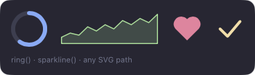
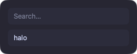

# Elements

Five building blocks: `Box`, `Text`, `Image`, `Shape` and `Input`. Boxes lay out their children with flexbox, and every
element takes a `style` object whose values can be signals.


```tsx
<Box
  style={{
    flexDirection: "row",
    align: "center",
    gap: 8,
    padding: [6, 10],
    background: "#1e1e2e",
    radius: 8,
  }}
>
  <Image symbol="battery.75percent" size={16} color="#cdd6f4" />
  <Text style={{ fontSize: 13, color: "#cdd6f4" }}>85%</Text>
</Box>
```

## Box

A container. Layout: `flexDirection`, `justify`, `align`, `padding`, `gap`, `width`, `height`, `grow`, `shrink`.
Paint: `background`, `borderColor`, `borderWidth`, `radius`, `corners`, `shadow`, `opacity`, `clip`. Transforms:
`scale`, `rotate`, `translateX`, `translateY`, `origin`. Colors are `#rgb`, `#rrggbb` or `#rrggbbaa`.



`radius` rounds every corner unless `corners` names some: `corners: ["bottomLeft", "bottomRight"]` keeps the top
square. All rounded corners share the one `radius`.



`shadow: { color, blur, x, y }` casts a shadow from the box's rounded shape (its children cast none); positive `y` is
down. A surface draws nothing past its edges, so leave padding around a shadowed box.



### Overlays

`position: "absolute"` takes an element out of the row or column and places it over its siblings, measured from the
parent's edges with `top`, `right`, `bottom` and `left` (points or `"50%"`). Set all four to 0 to cover the parent:

```tsx
<Box style={{ width: 56, height: 56 }}>
  <Shape path={ring()} style={{ width: 56, height: 56, … }} />
  <Box style={{ position: "absolute", top: 0, right: 0, bottom: 0, left: 0, justify: "center", align: "center" }}>
    <Text>{() => `${percent()}%`}</Text>
  </Box>
</Box>
```


Later siblings draw on top. A badge can hang outside its parent (`top: -4, right: -4`) and still gets clicks there.

### Clipping

Nothing clips by default. `clip: true` draws a box's children only inside its rounded shape, and clicks outside it
pass them by. Use it when a box animates its size while its content stays laid out at the final size:

<video src="../assets/clip.mp4" autoplay loop muted playsinline aria-label="Two cards spring between short and tall; the unclipped one lets its rows hang out, the clipped one cuts them at its edge"></video>

`<Input>` is a native field drawn above the surface, so a clipping ancestor doesn't cut it.

## Text

Box style plus `color`, `fontSize`, `fontWeight` (`"medium"`, `"bold"`, 100–900), `fontFamily`, `lines` (1 by
default, 0 = no limit) and `textAlign`. Long text is truncated with "…".



Emoji, CJK, right-to-left scripts and symbols
fall back to system fonts on their own, in any `fontFamily`; for SF Symbols use `<Image symbol>`.

## Image

One of `symbol` (an SF Symbol), `app` (a bundle id or `.app` path, for its icon) or `file`. `size` in points; `color`
tints symbols.



## Shape

Vector paths: progress rings, graphs, icons. `path` is SVG path data (arcs included) in a 100×100 `viewBox`; the
shape fits it into its own size.



```tsx
import { Shape, ring, sparkline } from "halo";

<Shape
  path={ring()}
  style={{
    width: 48,
    height: 48,
    fill: "transparent",
    stroke: "#89b4fa",
    track: "#313244",
    strokeWidth: 5,
    lineCap: "round",
    strokeEnd: () => (battery.percent() ?? 0) / 100,
    transition: { strokeEnd: 300 },
  }}
/>;
<Shape
  path={() => sparkline(history())}
  fit="stretch"
  style={{ height: 24, fill: "transparent", stroke: "#a6e3a1" }}
/>;
```

| Prop / style               | Does                                                                             |
| -------------------------- | -------------------------------------------------------------------------------- |
| `path`, `viewBox`          | The path and its coordinate space (default `[100, 100]`)                         |
| `fit`                      | `"contain"` (default) keeps proportions; `"stretch"` fills both axes, for graphs |
| `fill`                     | White by default; `"transparent"` for outlines only                              |
| `stroke`, `strokeWidth`    | Outline color and width in points (it stays inside the shape)                    |
| `track`                    | The whole path under the stroke: the empty part of a ring                        |
| `strokeStart`, `strokeEnd` | The drawn part of the stroke, 0–1                                                |
| `lineCap`, `lineJoin`      | `butt`/`round`/`square`, `miter`/`round`/`bevel`                                 |

Give a shape a size, like an empty Box. `ring()` starts at the top and goes clockwise; `sparkline(values, { min, max,
area })` draws a line graph.

## Input

A native text field. Needs `input="keyboard"` on its surface.



```tsx
<Input
  autofocus
  value={query}
  placeholder="Search…"
  onInput={query.set}
  onKeyDown={(event) => {
    if (event.key !== "Escape") return false;
    hide("launcher");
    return true;
  }}
/>
```

It has the usual macOS editing shortcuts: ⌘A, ⌘C, ⌘V, ⌘X, ⌘Z and ⌘⇧Z. `onKeyDown` gets every editing key with
modifiers, those shortcuts included; return `true` to stop the default.

`autofocus` takes focus whenever the surface does and when the field appears in a focused surface. `focus(node)` works
right after mounting too, from a `ref` or `onFocus`. Clicking elsewhere on the surface (a result row, a button) leaves
the field focused.

## Events

`onClick`, `onHover`, `onScroll` on Box, Text, Image and Shape. An event goes to the deepest element under the pointer that
listens for it. The surface needs `input="interactive"` (or `hover` for hover and scroll).

<video src="../assets/events.mp4" autoplay loop muted playsinline aria-label="A menu: rows highlight on hover and shrink when pressed"></video>

Here `onHover` and `onClick` set signals that drive `background` and `scale`, each with a `transition`.

## Drag and drop

Files in and out. You get paths; nothing is copied.

```tsx
import { drag } from "halo/services";

const shelf = signal<string[]>([]);

<Surface
  screen={screen}
  anchor={["top"]}
  input="interactive"
  visible={() => (drag.active() && !drag.outgoing()) || shelf().length > 0}
>
  <Box
    onDragEnter={() => over.set(true)}
    onDragLeave={() => over.set(false)}
    onDrop={({ files }) => shelf.update((list) => [...list, ...files])}
  >
    <For each={shelf} key={(path) => path}>
      {(path) => <Image app={path} size={40} draggable={() => ({ files: [path()] })} />}
    </For>
  </Box>
</Surface>;
```

| Prop / signal                | Does                                                                                |
| ---------------------------- | ----------------------------------------------------------------------------------- |
| `onDragEnter`, `onDragLeave` | Files dragged over the element, then away: highlight the zone                       |
| `onDrop`                     | `{ files, x, y }`: the dropped paths                                                |
| `draggable={{ files }}`      | Dragging the element out hands over the files; Finder moves or copies them as usual |
| `drag.active()`              | Files are being dragged anywhere: show drop zones only then                         |
| `drag.outgoing()`            | The drag started in a halo widget (`draggable`): skip drop zones for files leaving  |

- Only drags of files that exist on disk count (Finder, editors that drag their files). File promises (library items from
  Photos or video editors) and dragged text or web images don't trigger anything.
- Drop zones catch the pointer like any element with a listener. Keep them hidden until `drag.active()`, so they never
  sit over other apps.
- The surface needs `input="interactive"` (or `hover` for drops only).

## Refs

`ref={(node) => …}` hands out the element, for popups (`attach`), `focus()` and `animate()`.

Reference: [`halo`](../reference/halo.html).
