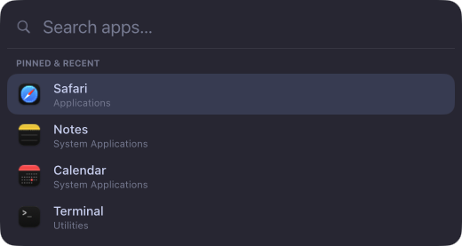

# Elements

Four elements, laid out with flexbox and styled with a `style` object.



```tsx
<Box
  style={{
    flexDirection: "row",
    align: "center",
    gap: 8,
    padding: [6, 10],
    background: "#1e1e2e",
    radius: 8,
  }}
>
  <Image symbol="battery.75percent" size={16} color="#cdd6f4" />
  <Text style={{ fontSize: 13, color: "#cdd6f4" }}>85%</Text>
</Box>
```

## Box

A container. Layout: `flexDirection`, `justify`, `align`, `padding`, `gap`, `width`, `height`, `grow`, `shrink`.
Paint: `background`, `borderColor`, `borderWidth`, `radius`, `opacity`. Transforms: `scale`, `rotate`, `translateX`,
`translateY`, `origin`. Colors are `#rgb`, `#rrggbb` or `#rrggbbaa`.

### Overlays

`position: "absolute"` takes an element out of the row or column and places it over its siblings, measured from the
parent's edges with `top`, `right`, `bottom` and `left` (points or `"50%"`). Set all four to 0 to cover the parent:

```tsx
<Box style={{ width: 56, height: 56 }}>
  <Shape path={ring()} style={{ width: 56, height: 56, … }} />
  <Box style={{ position: "absolute", top: 0, right: 0, bottom: 0, left: 0, justify: "center", align: "center" }}>
    <Text>{() => `${percent()}%`}</Text>
  </Box>
</Box>
```

Later siblings draw on top. A badge can hang outside its parent (`top: -4, right: -4`) and still gets clicks there.

## Text

Box style plus `color`, `fontSize`, `fontWeight` (`"medium"`, `"bold"`, 100–900), `fontFamily`, `lines` (1 by
default, 0 = no limit) and `textAlign`. Long text is truncated with "…". Emoji, CJK, right-to-left scripts and symbols
fall back to system fonts on their own, in any `fontFamily`; for SF Symbols use `<Image symbol>`.

## Image

One of `symbol` (an SF Symbol), `app` (a bundle id or `.app` path, for its icon) or `file`. `size` in points; `color`
tints symbols.

## Shape

Vector paths: progress rings, graphs, icons. `path` is SVG path data (arcs included) in a 100×100 `viewBox`; the
shape fits it into its own size.

```tsx
import { Shape, ring, sparkline } from "halo";

<Shape
  path={ring()}
  style={{
    width: 48,
    height: 48,
    fill: "transparent",
    stroke: "#89b4fa",
    track: "#313244",
    strokeWidth: 5,
    lineCap: "round",
    strokeEnd: () => (battery.percent() ?? 0) / 100,
    transition: { strokeEnd: 300 },
  }}
/>;
<Shape
  path={() => sparkline(history())}
  fit="stretch"
  style={{ height: 24, fill: "transparent", stroke: "#a6e3a1" }}
/>;
```

| Prop / style               | Does                                                                             |
| -------------------------- | -------------------------------------------------------------------------------- |
| `path`, `viewBox`          | The path and its coordinate space (default `[100, 100]`)                         |
| `fit`                      | `"contain"` (default) keeps proportions; `"stretch"` fills both axes, for graphs |
| `fill`                     | White by default; `"transparent"` for outlines only                              |
| `stroke`, `strokeWidth`    | Outline color and width in points (it stays inside the shape)                    |
| `track`                    | The whole path under the stroke: the empty part of a ring                        |
| `strokeStart`, `strokeEnd` | The drawn part of the stroke, 0–1                                                |
| `lineCap`, `lineJoin`      | `butt`/`round`/`square`, `miter`/`round`/`bevel`                                 |

Give a shape a size, like an empty Box. `ring()` starts at the top and goes clockwise; `sparkline(values, { min, max,
area })` draws a line graph.

## Input

A native text field. Needs `input="keyboard"` on its surface.

```tsx
<Input
  autofocus
  value={query}
  placeholder="Search…"
  onInput={query.set}
  onKeyDown={(event) => {
    if (event.key !== "Escape") return false;
    hide("launcher");
    return true;
  }}
/>
```

`onKeyDown` gets every editing key with modifiers; return `true` to stop the default.

## Events

`onClick`, `onHover`, `onScroll` on Box, Text, Image and Shape. An event goes to the deepest element under the pointer that
listens for it. The surface needs `input="interactive"` (or `hover` for hover and scroll).

## Refs

`ref={(node) => …}` hands out the element, for popups (`attach`), `focus()` and `animate()`.

Reference: [`halo`](../reference/halo.html).
