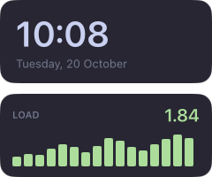

# Reactivity

Components run once. What changes afterwards is driven by signals.



```tsx
import { computed, signal } from "halo/signals";

const count = signal(0);
const even = computed(() => count() % 2 === 0);
setInterval(() => count.update((n) => n + 1), 1000);

<Text style={{ color: () => (even() ? "#89b4fa" : "#f9e2af") }}>
  {() => `${count()}`}
</Text>;
```

## Rules

<video src="../assets/signals.mp4" autoplay loop muted playsinline aria-label="A counter, a derived even/odd label and a list, all updating from signals"></video>

- Read a signal by calling it: `count()`. Write with `count.set(1)` or `count.update((n) => n + 1)`.
- A function in a prop or style value is reactive; a plain value is set once.
- In `<Text>`, only function children update: `{() => `WS ${ws()}`}`, not `WS {ws()}`.
- A function child of a `<Box>` re-renders when what it reads changes: `{() => items().map(Row)}`.

## Lists

```tsx
<For each={tasks} key={(task) => task.id}>
  {(task, index) => <Text>{() => `${index() + 1}. ${task().title}`}</Text>}
</For>
```

`<For>` renders each key once and keeps its nodes and state; when the list changes it only renders new keys, removes
old ones (playing their `exit`) and moves the rest. `task` and `index` are signals that follow a kept key's value and
position. `key` defaults to the item itself.

## Effects and cleanup

```tsx
effect(() => console.log("now", count()));
onCleanup(() => console.log("widget removed"));
```

Effects, timers, `poll`, `watchFile` and `spawn` started in a component stop when it goes away or the config reloads. `batch()` groups
writes into one update.

## Getting data

| Helper                                                                  | Use                                                              |
| ----------------------------------------------------------------------- | ---------------------------------------------------------------- |
| `clock.format("HH:mm")`                                                 | Time and date, ticking only as often as the pattern needs.       |
| `battery`, `audio`, `network`, `frontApp`, `power`, `session`, `system` | System state ([guide](services.html)).                           |
| `sh("cmd")`, `exec(…)`                                                  | Run a command once; resolves with its output.                    |
| `poll("cmd", 5000)`                                                     | A signal of a command's output, refreshed on an interval.        |
| `spawn("cmd", args, { onLine })`                                        | A long-running program's output, line by line.                   |
| `readFile`, `writeFile`, `watchFile`                                    | Files: read once, save, or follow as a signal.                   |
| `externalSignal("name")`                                                | State pushed by `halo trigger` ([guide](external-signals.html)). |

## Files and processes

```tsx
import { readFile, spawn, watchFile, writeFile } from "halo";

const note = watchFile("~/notes/today.md"); // undefined while missing; follows saves and deletes
const saved = await readFile("~/.cache/my-bar/state.json"); // rejects if missing
writeFile("~/.cache/my-bar/state.json", JSON.stringify(state)); // atomic, creates folders

spawn("/sbin/ping", ["-i", "2", "1.1.1.1"], {
  onLine: (line) => latency.set(Number(line.match(/time=([\d.]+)/)?.[1])),
});
```

- `~` is your home folder; relative paths start at the config folder.
- Keep state outside the config folder: writes there reload the config.
- `spawn` takes a program and arguments, no shell (use `"/bin/sh", ["-c", "…"]` for one). Stopping it, by hand or
  with its owner, also stops anything it started. Unhandled stderr goes to `halo log`.

Reference: [`halo/signals`](../reference/halo-signals.html), [`halo/services`](../reference/halo-services.html).
