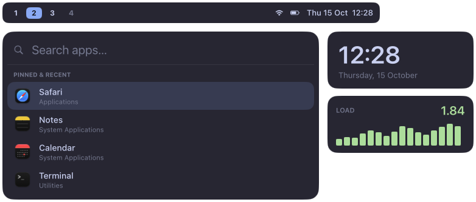

<p class="lead">Desktop widgets for macOS, written in TSX. Native rendering, reactive state, reload on save.</p>



<p class="cta"><a href="guide/getting-started.html">Read the docs</a><a href="https://github.com/bfpimentel/halo">GitHub</a></p>

## Why

- **Native.** Core Animation layers and Yoga flexbox. No browser; ~0% CPU when idle.
- **Reactive.** Signals update exactly the properties that read them.
- **Batteries included.** Battery, volume, network, front app, CPU and memory as signals.
- **Scriptable.** `halo trigger` pushes state from your window manager or any script.

## Install

```bash
brew tap bfpimentel/halo https://github.com/bfpimentel/halo
brew install --HEAD halo
```

Nix: `inputs.halo.url = "github:bfpimentel/halo"` with `services.halo.enable = true` (nix-darwin or home-manager).

## A widget

```tsx
// ~/.config/halo/main.tsx
import { Box, PerScreen, Surface, Text } from "halo";
import { clock } from "halo/services";

const time = clock.format("HH:mm");

export default () => (
  <PerScreen>
    {(screen) => (
      <Surface
        screen={screen}
        anchor={["bottom", "right"]}
        margins={[0, 16, 16, 0]}
        layer="desktop"
      >
        <Box style={{ padding: [10, 16], background: "#1e1e2ee0", radius: 12 }}>
          <Text style={{ fontSize: 22, fontWeight: "bold", color: "#cdd6f4" }}>
            {time}
          </Text>
        </Box>
      </Surface>
    )}
  </PerScreen>
);
```

```bash
halo start
```
